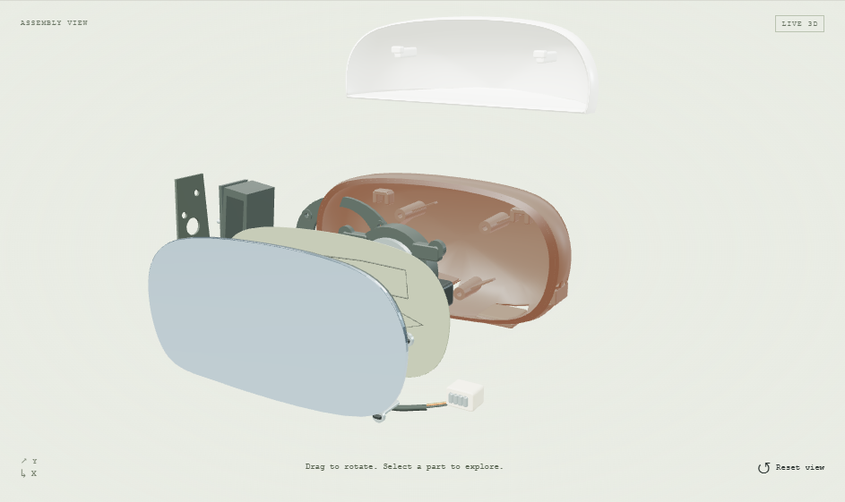

# Door mirror

A standalone, interactive cost-engineering study by Guven. Rotate an original generic exterior mirror, separate its parts, switch Low / Mid / High specification and explore qualitative cost ideas.



## Run locally

Requires Node.js 24 and npm. Chrome must be installed for the browser tests.

```powershell
npm install
npm run dev
```

Open the local URL printed in the terminal. The default is `http://127.0.0.1:5173`.

The viewer only imports three.js and fetches its GLB after **Load 3D viewer** is activated. The HTML parts explorer works before activation and remains usable if WebGL fails. Zoom uses explicit buttons so the canvas does not capture the mouse wheel. Vertical touch gestures and pinch remain available to the page.

## Check and build

```powershell
npm test
npm run build
npm run preview
```

`npm test` runs the behavior and asset tests, builds the production bundle, then runs the Chrome browser suite against a temporary preview server. It includes accessibility scans at desktop and phone widths, initial network behavior, model loading, picking, drag suppression, specifications, animation, failure/retry, reduced motion and visibility pausing. Screenshots go to ignored `tmp/screenshots/`. Browser traces are retained on failure.

The first setup in this restricted session used existing local dependency archives. A clean online installation has not been verified. No credentials, external APIs or environment variables are required.

## Model and poster

`scripts/model.mjs` is the editable source of the original procedural assembly. Blender is optional. The exported model can be imported into Blender later, although the procedural source remains the authoritative authoring file unless that workflow changes.

```powershell
npm run assets
npm test
Copy-Item -LiteralPath tmp\screenshots\mirror-poster.png -Destination public\mirror\poster.png
npm run build
```

The asset command merges compatible geometry within each selectable group and exports `public/mirror/mirror.glb`. It also writes measured statistics to `public/mirror/model-info.json`. The browser suite captures a transparent poster from the actual Low-spec scene. Copy it after intentional geometry or framing changes, not after every test run.

The current GLB is 1,602,840 bytes with 29,604 triangles, 14 selectable groups and 68 render meshes. The fifteenth logical entry, auto-dimming, changes the existing glass surface. Materials and dimensions are illustrative. The model is a visualization, not a manufacturing drawing or a validated structural design.

## Manufacturing evidence

Every part insight separates its function, a conditional cost proposal, checks still needed and links to primary evidence. The sources include manufacturing guidance, current component offerings and published designs. A patent describes an architecture, not proof of market adoption or permission to reproduce it. The original geometry does not copy a commercial mirror.

The [manufacturing review](docs/manufacturing-review.md) covers all fifteen logical entries. The repaired illustration includes an inward-facing housing wall, connected ribs, hollow screw posts, a glass carrier, a two-terminal heater circuit, an upright fold pivot and option apertures with blanks. The signal and camera have exposed outward/downward sight lines, checked by raycasts against the whole assembled model.

This establishes a clearer representative architecture. Tool release, exact wall thickness, dimensional tolerances, durability, heating, optical performance, sealing and structural strength still need product engineering and physical validation before manufacture. The model is not a production-ready CAD release.

## Source map

- `src/template.ts`: page structure and standalone presentation.
- `src/main.ts`: controls, inspector, loading states and animation.
- `src/parts.ts`: stable IDs, level rules and approved qualitative captions.
- `src/evidence.ts`: public source links, evidence types and precisely bounded support statements.
- `src/viewer.ts`: lazy three.js renderer, picking and resource cleanup.
- `src/styles.css` and `src/workbench.css`: responsive visual styles.
- `scripts/model.mjs` and `scripts/build-model.mjs`: editable geometry and GLB export.
- `tasks/agreement.md`: interaction and content contract.
- `tasks/verification.md`: actual checks and remaining review gaps.

## Later site integration

This app is local and independent. It has no deployment configuration, analytics, accounts or contact form. Existing websites have not been changed.

Use the viewer lifecycle API and parts registry inside the target site's component. Keep the dynamic import inside explicit activation. Copy the local assets to the intended same-origin directory and adjust asset URLs and styles to the host. Dispose the viewer when its component unmounts. Move the English copy into the host's dictionaries and add translations before exposing the section in other languages. Add CV/contact links only when actual destinations are available.

Production output uses same-origin runtime assets. The HTML CSP allows a loopback WebSocket for Vite's local development connection. The eventual host must apply its own production CSP without broadening it for remote scripts or models.

The production viewer chunk is about 149 KB gzipped and loads only after activation. Vite reports its uncompressed size as above its advisory chunk threshold. The initial page does not request that chunk, as verified by the browser test.

Implementation references: [three.js GLTFLoader](https://threejs.org/docs/#examples/en/loaders/GLTFLoader), [OrbitControls](https://threejs.org/docs/#examples/en/controls/OrbitControls) and [Vite](https://vite.dev/guide/).

## Initial GitHub publication

The user authorized a public repository at `guventech/door-mirror`. If the agent session cannot write Git metadata or reach GitHub from its CLI, run this once from a normal PowerShell terminal in this project:

```powershell
pwsh -File .\scripts\publish-github.ps1
```

The script checks the signed-in account and target, commits the project, creates `main`, creates the public repository and pushes it. It preserves a separate local feature branch and does not force-push or alter a pre-existing unrelated repository. It requires working GitHub CLI authentication and normal network access. It has not been executed in the restricted agent session.
